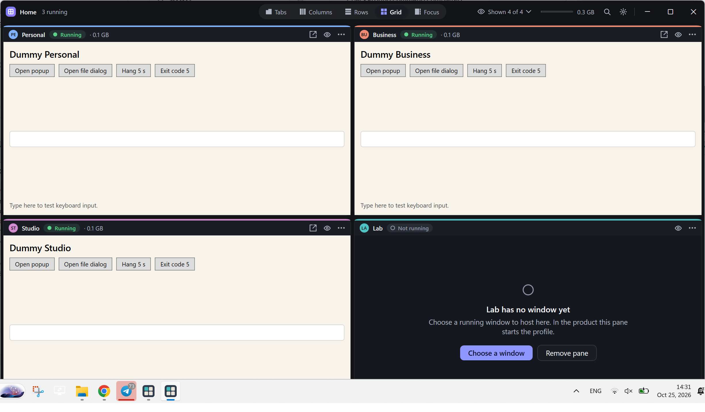
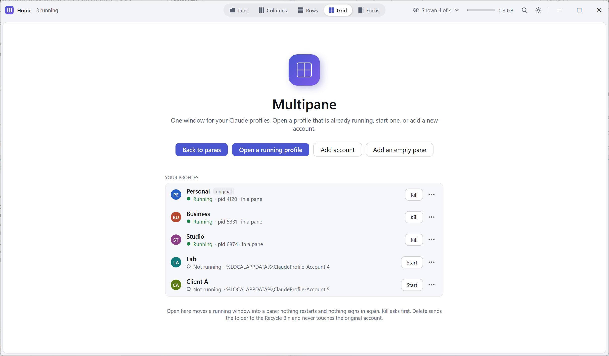

# Multipane

One window for all your Claude Desktop profiles on Windows. Tabs, columns, rows, grid or focus; start, kill and reopen sessions; a crashed session stays put with a Reopen button instead of vanishing.



**Status: early.** What exists today is a working spike: the shell from the design, hosting of real Claude windows, the profile page (open, start, kill, add, rename, delete), light and dark themes. It builds from `spikes/hosting`. The product build with tests, the native modules and signed releases is the next phase; see `docs/tech/README.md`. Treat the spike as a preview, not a release.

## What it does

- Finds every profile the Claude Profile Switcher created, plus the original account, and uses them where they are. Nothing is moved, copied or signed in again.
- Hosts the running Claude windows inside one window: Tabs, Columns, Rows, Grid (2+1, 2×2, 3+2, 3×2, 3×3) or Focus (one large pane plus a strip).
- Pop a pane out into its own window and dock it back. Hide a session without killing it.
- Kill asks first and says what will stop. Delete sends the profile folder to the Recycle Bin and never touches the original account.



## What it never does

No network access of any kind. No reading of cookies, tokens, chats or anything inside a Claude profile folder. No code injection, no debugging ports: only Electron's documented `--user-data-dir` switch and standard Windows window and process APIs. No admin rights, services or scheduled tasks. The full list of folders, registry keys and APIs it touches is in [docs/trust/what-this-app-touches.md](docs/trust/what-this-app-touches.md), and [SECURITY.md](SECURITY.md) says how to check it in under an hour.

## Download the preview

Grab `Multipane-<version>-win-x64.zip` from the [latest release](https://github.com/ReactRuler/multipane/releases/latest), unzip it anywhere and run `Multipane.exe`. Needs Windows 10 or 11 and the [.NET 8 Desktop Runtime](https://dotnet.microsoft.com/download/dotnet/8.0). The build is not code-signed yet, so SmartScreen asks once; every release ships `SHA256SUMS.txt` and a GitHub build provenance attestation (`gh attestation verify <zip> --owner ReactRuler`) so you can check that the file is exactly what the workflow built from the tagged source.

Or build it yourself:

```bash
dotnet build spikes/hosting/HostingSpike -c Release
```

Then run `spikes/hosting/HostingSpike/bin/Release/net8.0-windows/Multipane.exe`. `--selftest` runs the automated checks on dummy windows; `--demo grid` shows the shell with dummy windows and made-up profiles, no Claude involved. Details in [spikes/hosting/RUN.md](spikes/hosting/RUN.md).

Hosting takes a window's frame away until it is released, so start with a profile you are not working in.

## Documents

- Design: [docs/design/DESIGN.md](docs/design/DESIGN.md)
- Technical documents and open decisions: [docs/tech/README.md](docs/tech/README.md)
- Trust: [docs/trust/](docs/trust/)
- Hosting spike findings: [spikes/hosting/RESULTS.md](spikes/hosting/RESULTS.md)
- Launch plan: [docs/launch/plan.md](docs/launch/plan.md)

## Credits and licence

MIT. Multipane builds on the [Claude Profile Switcher](https://github.com/PriyanshuGeTRekT/Claude-Code-Desktop-Switcher) and [claude-switcher](https://github.com/Piwqust/claude-switcher); see [NOTICE](NOTICE). All screenshots show demo mode: dummy windows and made-up profiles.

Multipane is an independent, open-source tool. It is not made by, affiliated with, or endorsed by Anthropic. Claude is a trademark of Anthropic, PBC. Using more than one Claude account is subject to Anthropic's terms of service; check them before you rely on this tool.
