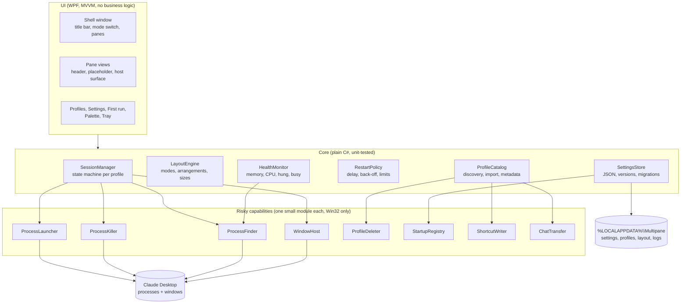

# 01 · Architecture overview

Multipane is a single Windows process that launches, finds, hosts and watches Claude Desktop processes. It never links to Claude, never injects into it, and never opens the network. Everything it knows about a session comes from three public sources: the process list, the window list, and files it wrote itself.

## Stack decision

**C# on .NET 10 (LTS) with WPF, x64 and ARM64, framework-dependent build with ReadyToRun.**

| Criterion | WPF (.NET 10) | WinUI 3 | Native C++ / Win32 (the claude-switcher approach) |
| --- | --- | --- | --- |
| Reliability of window hosting | Good. `HwndHost` and raw `SetWindowPos` work; WPF's own HWND is a plain top-level window, so owner links, hide/show and z-order behave predictably. | Weak. WinUI 3 windows are composed; mixing foreign HWNDs needs XAML Islands and has known DPI and focus bugs. | Best. Everything is an HWND. |
| Readability for auditors | High. C# reads like prose, one language, well-known project layout. | Medium. More boilerplate, WinAppSDK packaging. | Low for a GUI of this size: several thousand lines of Direct2D and message loops before the first feature. |
| Startup time | ~0.4–0.8 s with ReadyToRun and a trimmed XAML tree. | 1 s or more. | ~0.1 s. |
| Memory | 45–70 MB. Over the 60 MB target is a risk (see risks doc). | 90 MB+. | ~15 MB. |
| Release size | Framework-dependent: ~3 MB plus the .NET Desktop Runtime the user may already have. Self-contained: ~70 MB. | Needs WinAppSDK runtime. | ~1 MB. |
| Windows 10 support | Yes. | Partial. | Yes. |
| Mica / acrylic | Via DWM attributes on the HWND (Windows 11 only), plain colour on Windows 10. | Built in. | Via DWM. |

WPF wins on the two things the brief weighs most, hosting reliability and auditability, and loses only on raw footprint. Native C++ is the honest second choice if the 60 MB ceiling turns out to be hard; the module boundaries below are drawn so that a port would keep the same shape.

Framework-dependent versus self-contained is a decision for the owner (decisions doc, D2). Framework-dependent keeps the download small and lets Windows Update patch the runtime; self-contained has no prerequisite.

## Components

### UI

- **Shell window.** One WPF `Window` with a custom title bar (`WindowChrome`), the mode switch, Shown menu, memory readout, and a `Grid` that the layout engine fills with pane views. Mica or acrylic is applied through `DwmSetWindowAttribute` on Windows 11; on Windows 10 the window has a flat background.
- **Pane view.** Header (profile badge, state, memory, actions), and below it either a placeholder control or a *host surface*: an empty area whose screen rectangle is reported to `WindowHost` every time it changes.
- **Secondary windows.** Profiles, Settings, First run, the command palette and popped-out panes are ordinary WPF windows. The tray icon is a `NotifyIcon` via Shell_NotifyIcon with a native context menu, and a WPF flyout window.

The UI holds no process handles and calls no Win32 API directly except DWM theming. It binds to view models that expose the Core's state.

### Core

- **SessionManager** owns one `Session` per profile and runs the state machine in the state-machine doc. It is the only caller of `ProcessLauncher`, `ProcessKiller` and `WindowHost`.
- **LayoutEngine** is pure: given a mode, an ordered list of visible sessions, a content rectangle and saved fractions, it returns a rectangle per session. No WPF types.
- **ProfileCatalog** finds profiles on first run (both old switchers' settings, both folder layouts, the original account), keeps names, colours and order, and validates names.
- **RestartPolicy** is a pure function of crash history and settings: "restart in N ms" or "stop, reason".
- **HealthMonitor** samples each session's process tree every N seconds and raises threshold events.
- **SettingsStore** reads and writes the three JSON files with schema versions and migrations.

### Risky capabilities

Each is one file under `src/Multipane.Native/`, with a one-paragraph header saying what it touches and why, and no dependency on the rest of the app except small value types. A reviewer reads those eight files to audit the app. The full list with APIs is in `docs/trust/what-this-app-touches.md`.

### Data

Only `%LOCALAPPDATA%\Multipane\` (or `.\data\` in portable mode): `settings.json`, `profiles.json`, `layout.json`, `logs\`. Schemas in doc 07.

## Threads

- UI thread: WPF.
- One background `PeriodicTimer` loop (every 2 s) that refreshes the process map and window handles; one (every 3 s, configurable) for memory and CPU samples; both post results to the UI thread.
- A WinEventHook (`EVENT_OBJECT_CREATE`/`SHOW`/`DESTROY`, out-of-context) so new Claude windows are noticed within milliseconds instead of at the next tick.
- Process exit is observed with a `RegisterWaitForSingleObject` on each process handle; no polling for exits.

## Dependencies

| Package | Purpose | Licence | Why it is needed |
| --- | --- | --- | --- |
| Microsoft.Windows.CsWin32 (build-time only, source generator) | Typed P/Invoke signatures from the Win32 metadata | MIT | Avoids hand-written `DllImport` mistakes; generates only the APIs listed in `NativeMethods.txt`, which doubles as the audit list. Nothing ships in the binary. |
| System.Text.Json (in the runtime) | Settings files | MIT | In-box. |
| xunit, xunit.runner.visualstudio (tests only) | Unit tests | Apache-2.0 | Standard. |

No MVVM framework, no UI control library, no logging framework (a 120-line file logger), no installer runtime inside the app. Anything added later goes through the review in doc 09.

## What is deliberately not here

No web view, no plugin loading, no scripting, no update check, no crash reporter, no analytics. The app's only outputs are its own JSON files, its log, Windows shortcuts the user asked for, and one registry value the user turned on.
