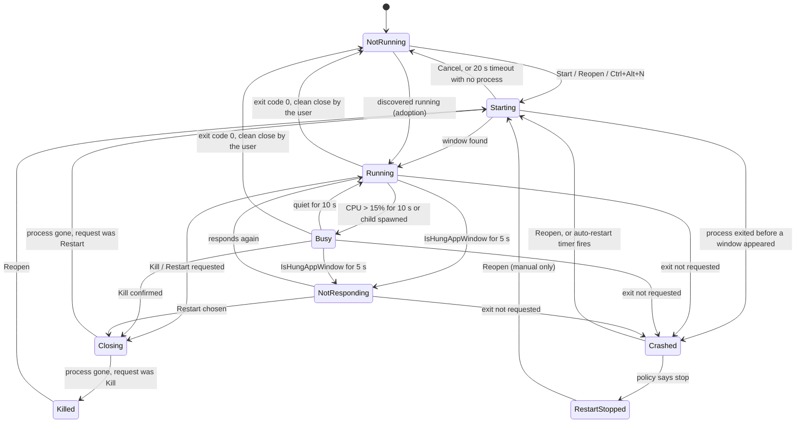

# 04 · Session state machine and restart policy

One `Session` per profile. States are what the pane header shows; transitions are what `SessionManager` does. Every transition is logged with the profile id, the old and new state and the trigger.



Hidden-from-layout and popped-out are not states of the session; they are layout flags on the pane. A hidden session can crash and its placeholder will be there when it is shown again.

## State table

| State | Entered when | Header shows | Actions offered | Pane body |
| --- | --- | --- | --- | --- |
| Not running | first seen, user closed Claude, Start cancelled | hollow ring, "Not running · closed by you at HH:MM" or "never started" | Start, Hide, menu | placeholder "X is not running" |
| Starting | launch issued | dashed ring, elapsed seconds | Cancel | placeholder with elapsed time |
| Running | window found | filled dot, memory, CPU | Restart, Kill, Pop out, menu | hosted window |
| Busy | heuristic | ring with dot, memory, CPU | same; Kill and Restart confirm first | hosted window |
| Not responding | hung ≥ 5 s | clock, seconds | Wait, Restart, Kill | hosted window plus a bar |
| Closing | kill in progress | dashed ring, "Closing" | none | hosted window fading to placeholder |
| Killed | exit after Kill | square, time | Reopen, menu | placeholder "You killed X at HH:MM" |
| Crashed | exit not requested | triangle, time | Reopen, Details, (Restart now / Stop when auto-restart is on) | placeholder with exit code and, when on, the countdown |
| Auto-restart stopped | policy limit | slashed ring, "N crashes in M min" | Reopen, Open log | placeholder saying why |

Per-session data kept: `pid`, `mainHwnd`, `startedAt`, `lastExit { at, code, classifiedAs }`, `crashTimes[]` (ring of the last 20), `restartAttempt`, `pendingRequest` (`None | Kill | Restart`), `busySince`, `hungSince`.

## Crash classification

An exit is a crash unless the app asked for it (`pendingRequest != None`) or it was a clean close (exit code 0 and the main window was destroyed at least 200 ms before the process ended). Exit code and classification are shown in Details and logged; the host never guesses a cause.

## Restart policy

Settings, global with per-profile override:

| Field | Default | Range |
| --- | --- | --- |
| `enabled` | false | |
| `initialDelayMs` | 5000 | 1000–60000 |
| `backoff` | 2.0 | 1.0–4.0 |
| `maxDelayMs` | 60000 | |
| `maxCrashes` | 5 | 1–20 |
| `windowMs` | 600000 (10 min) | |
| `resetAfterMs` | 600000 | time Running without a crash before `restartAttempt` goes back to 0 |

`RestartPolicy.Decide(now, crashTimes, restartAttempt, settings)` returns `Restart(delay)` or `Stop(reason)`:

```
crashesInWindow = count of crashTimes within windowMs of now
if crashesInWindow >= maxCrashes: return Stop("N crashes in M minutes")
delay = min(initialDelayMs * backoff ^ restartAttempt, maxDelayMs)
return Restart(delay)
```

It is a pure function and the test plan covers it with a table of cases. While the countdown runs the placeholder shows "Restarting in N s · attempt A of maxCrashes", with Restart now (fires immediately) and Stop auto-restart (moves to Crashed without a timer, policy untouched). A manual Reopen resets `restartAttempt` to 0; a successful run of `resetAfterMs` does too.

Auto-restart never applies to Killed or Not running, only to Crashed.

## Adoption and the first state

On host start, discovery runs before the shell is shown. Found pids enter `Running` directly, with `startedAt` taken from the process creation time. Profiles not found enter `Not running` with the last known end state from `layout.json` (so a pane that was Crashed when the host closed is shown as Crashed with its time, not as a blank Not running).

## What the user is told after a crash

Placeholder body, fixed wording: "Exit code 0x…. Your conversations are kept. Work that was running inside this session stopped and needs to be resumed." The claim is honest: Claude's data is on disk in the profile folder and the app did not touch it; anything that was executing in that process is gone.
